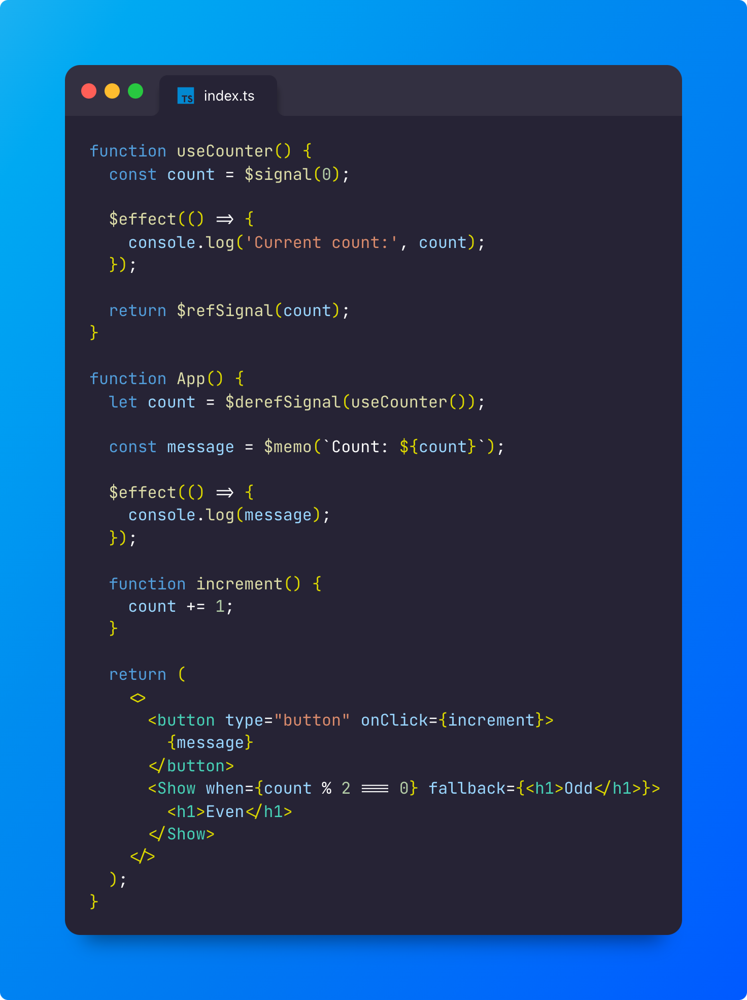

# `solid-labels`

[](https://www.npmjs.com/package/solid-labels) [](https://github.com/airbnb/javascript)

<p align="center">
  
</p>

> This version targets **Solid 2.0** (`solid-js@2.0.0-rc.1` and `@solidjs/web@2.0.0-rc.1`). For Solid 1.x, use `solid-labels@0.17` or older.

## Install

```bash
npm install solid-labels
```

```bash
yarn add solid-labels
```

```bash
pnpm add solid-labels
```

## Features

- ⏱ Compile-time Functions: Use functions that are evaluated during compile-time!
- 📦 Auto Imports: No need to import SolidJS utilities, explicitly!
- ⚡ Oxc-powered: native-speed parsing, span-based output, high-resolution source maps!
- 🤝 JS and TS Friendly!

> Labels (`signal: x = 0`) and comment pragmas (`/* @signal */`) were removed
> in 1.0 — see the [migration guide](/docs/migration).

## Usage

<!-- TODO: the links below are paths on the documentation website. Make them full URLs when the domain is known. -->

- [Compile-Time Functions](/docs/ctf)
  [](https://codesandbox.io/s/github/LXSMNSYC/solid-labels/tree/main/examples/ctf)
- [Solid Namespace](/docs/namespace)
- [Migration from 0.x](/docs/migration)
- [REPL](/repl)

### Typescript

`<any file>.d.ts`

```ts
/// <reference types="solid-labels" />
```

### Programmatic

```ts
import { compile } from 'solid-labels/compiler';

const { code, map } = compile('App.tsx', source, { dev: true });
```

## Integrations

- [Unplugin](https://github.com/lxsmnsyc/solid-labels/tree/main/packages/unplugin)
  serves Vite, Rollup, webpack, esbuild, and Bun through
  [unplugin](https://github.com/unjs/unplugin) adapters
  (`solidLabels.vite(options)`, `solidLabels.rollup(options)`, `solidLabels.bun(options)`, and so on).

### Bun

Bun uses the first `onLoad` that returns contents, so `solidLabels.bun()` and a separate Solid JSX
plugin never chain, in either order. Put both in one unplugin factory, which runs them in order
inside a single `onLoad` and combines their source maps:

```ts
import { transformAsync } from '@solidjs/compiler';
import { createUnplugin } from 'unplugin';
import type { UnpluginOptions } from 'unplugin';
import solidLabels from 'unplugin-solid-labels';

const solidJsx: UnpluginOptions = {
  name: 'solid-jsx',
  transform: {
    filter: { id: /\/src\/.*\.[jt]sx$/ },
    async handler(code, id) {
      const result = await transformAsync(code, { filename: id, generate: 'dom', sourceMap: true });
      return { code: result.code, map: result.map };
    },
  },
};

const solidBun = createUnplugin((_options: undefined, meta) => [
  solidLabels.raw({}, meta),
  solidJsx,
]).bun;

await Bun.build({
  entrypoints: ['./src/main.tsx'],
  outdir: './dist',
  plugins: [solidBun()],
});
```

See the [unplugin README](https://github.com/lxsmnsyc/solid-labels/tree/main/packages/unplugin#bun)
and [`examples/bun`](https://github.com/lxsmnsyc/solid-labels/tree/main/examples/bun).

### Disabling features

You can disable some features by passing `disabled` option to the plugin options.

```js
{
  disabled: {
    ctf: {
      $signal: true,
    },
  }
}
```

## Sponsors


## License

MIT © [lxsmnsyc](https://github.com/lxsmnsyc)
